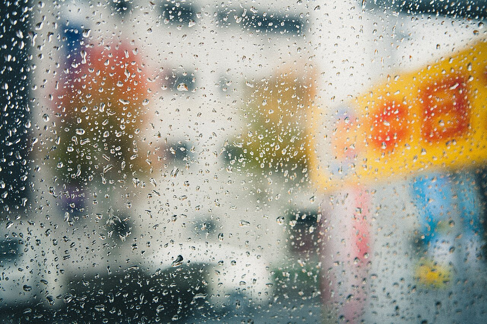
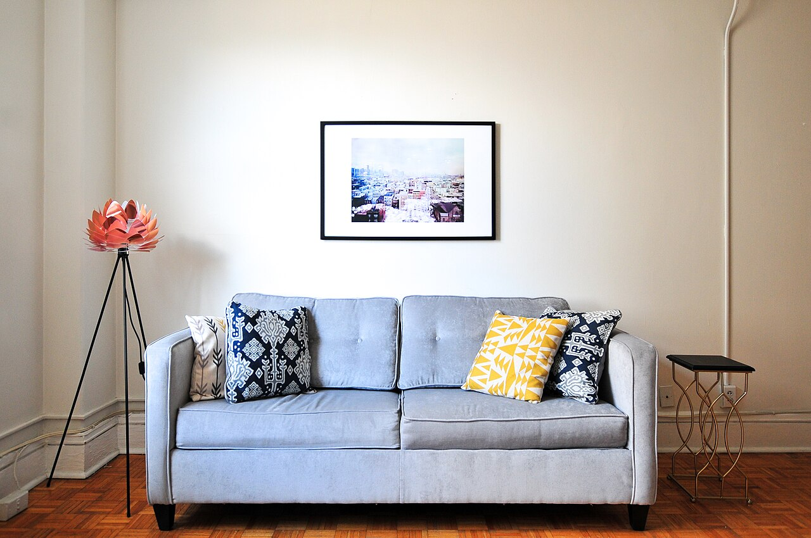
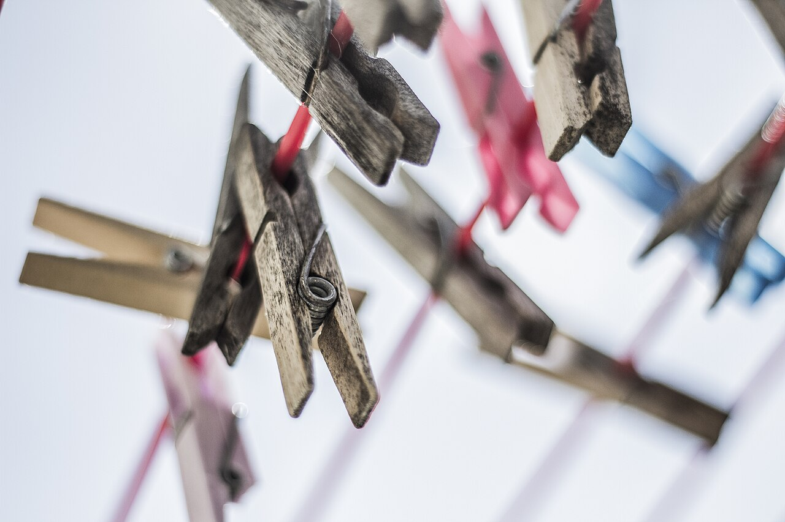

*本站部分外部連結可能包含聯盟行銷分潤，這不會影響您的購買價格，並能支持我們持續產出真實評測。*

租屋處最常見的潮濕問題，是房間悶濕、衣服晾不乾、牆角與衣櫃發霉。多數租屋族的難處在於：空間小、預算有限、搬家頻繁，買太大的除濕機放不下，買太便宜的又怕根本沒效果。

本文選擇在 Dcard 與 Threads 租屋討論中常被提到的兩款有壓縮機的 6 公升級除濕機：SHARP 夏普 DW-X6NT-W 與禾聯 HERAN HDH-12DY030，整理官方規格、市場價差與網友常見缺點。**需要先說明：以下規格來自官方與電商頁面的整理，並非本站實驗室量測；價格會隨檔期變動，下單前請以商品頁為準。**

## 一、租屋族買除濕機前，先看這四件事

### 1. 壓縮機式與半導體式差很多
網友討論中有一個明確共識：不要隨便買幾百元的無牌半導體式迷你除濕機，常被形容成「升級版除濕盒」，一天抽出的水量很有限。半導體式比較適合衣櫃、鞋櫃或浴室這類極小空間。

### 2. 有晾衣需求，就別選太小
網友常提醒，如果房間會室內晾衣，選太小的機型效果有限，建議選有壓縮機、6 公升以上的款式。

### 3. 看能效與電費
壓縮機式機型建議挑一級能效，長時間運轉的電費差異才不會太大。購買符合規定的節能家電，也可申請貨物稅退稅（兩款在資料中都標示可退 500 元，實際以當期規定為準）。

### 4. 機身尺寸、重量與水箱
租屋桌面與牆角空間珍貴，搬家時機身重量也很實際。水箱太小則需要頻繁倒水。

## 二、兩款機型規格與價格對比

以下數值均為官方或電商頁面標稱值。

| 比較項目 | SHARP DW-X6NT-W | 禾聯 HDH-12DY030 |
| --- | --- | --- |
| 除濕能力 | 6 公升／日 | 6 公升／日 |
| 能源效率 | 第 1 級 | 新一級能效 |
| 水箱容量 | 2.8 公升 | 2.3 公升 |
| 額定功率 | 111 W | 110 W |
| 機身重量 | 9.4 kg | 11.4 kg |
| 機身尺寸（寬×深×高） | 約 26 × 24 × 46.4 cm | 約 30.8 × 22.9 × 47.8 cm |
| 運轉音量 | 約 30 dB | 資料未標示 |
| 特色功能 | 自動除菌離子、4 種除濕模式、4 段濕度設定 | 奈米銀抑菌、除濕與乾衣模式、1～24 小時定時、支援連續排水（需自備排水管） |
| 適用坪數 | 資料未標示 | 約 4～6 坪 |
| 官方建議價／市場價 | 官方建議價約 7,490 元；電商約 6,100～7,490 元 | 網路價約 3,990～4,500 元 |

從表格可以看出：兩款的除濕能力與能效等級相同，但價格差距相當明顯。SHARP 的優勢在於機身較輕、水箱稍大，並有除菌離子與濕度設定；禾聯則以價格與連續排水功能見長。

### 1. SHARP DW-X6NT-W：適合重視輕量與功能的人
機身 9.4 kg、水箱 2.8 公升、標示約 30 dB 的運轉音量，對睡眠空間較友善。預算較充裕、希望機身輕便好移動的租屋族可以評估。

### 2. 禾聯 HDH-12DY030：適合預算優先的人
價格約為 SHARP 的一半上下，並支援連續排水。若浴室或排水點靠近、願意自備排水管，可以減少倒水次數。機身較重、水箱較小，是取捨的地方。

## 三、真實市場災情與常見缺點（來源：網友討論整理）

以下整理自 Dcard、Threads 及部落格的公開討論，屬於「網友常見反映」，並非本站逐一查證的個案，也不特指上述兩款機型。

| 災情類型 | 常見描述 | 建議做法 |
| --- | --- | --- |
| 買到無牌半導體式機型 | 一天抽水量很少，被形容為電子垃圾 | 有明顯除濕需求就選壓縮機式 |
| 容量買太小 | 室內晾衣時曬不乾，霉味更重 | 有晾衣需求選 6 公升以上 |
| 水箱需頻繁倒水 | 水箱容量有限，高濕度時需要多次倒水 | 評估連續排水或增加機型放置位置 |
| 耗電成本 | 沒有挑一級能效，長時間運轉電費偏高 | 優先選一級能效機型 |

### 1. 水箱倒水頻率（依標稱值推算）
以日除濕能力 6 公升、水箱 2.8 公升與 2.3 公升來推算，在高濕度、機器持續運轉的情況下，一天可能需要倒水 2 到 3 次。實際頻率取決於房間濕度與使用時間。

### 2. 不要期待一台機器解決所有問題
除濕機能降低室內濕度，但無法取代通風；房間漏水、壁癌等結構問題，仍需與房東或專業人員處理。

## 四、怎麼選？依需求整理

| 你的需求 | 建議方向 |
| --- | --- |
| 預算優先、願意自備排水管 | 評估禾聯 HDH-12DY030 |
| 重視機身輕量與較大水箱 | 評估 SHARP DW-X6NT-W |
| 房間會室內晾衣 | 選有壓縮機、6 公升以上的機型 |
| 只想放衣櫃、浴室 | 才考慮半導體式迷你機 |
| 常搬家 | 比較機身重量與是否附滑輪 |

👉 [點此查看 SHARP 夏普 DW-X6NT-W 官方最新優惠](https://tw.sharp/products/dw-x6nt-w)

👉 [點此查看 禾聯 HERAN 官方網站與最新資訊](https://www.heran.com.tw/)

## 五、購買前檢查清單

1. 確認房間坪數與是否有室內晾衣需求。
2. 確認擺放空間，量好機身尺寸。
3. 比較不同通路的現價與保固。
4. 確認是否為一級能效，並了解貨物稅退稅規定。
5. 若想使用連續排水，確認排水管規格與排水位置。

## 六、選購結論

預算優先，且願意為連續排水自備排水管，禾聯 HDH-12DY030 的價格門檻較低；若重視機身重量、水箱容量與濕度設定功能，並且預算較寬裕，SHARP DW-X6NT-W 值得納入比較。不論選哪一款，重點是挑有壓縮機、一級能效、容量符合房間與晾衣需求的機型，避免買到效果有限的迷你半導體式產品。

**注意事項：** 本文規格、價格與使用者反饋均為整理資訊，可能隨時間變動；實際購買前請以官方與商品頁面為準。使用電器時請注意用電安全，避免與其他高功率電器共用同一延長線。
